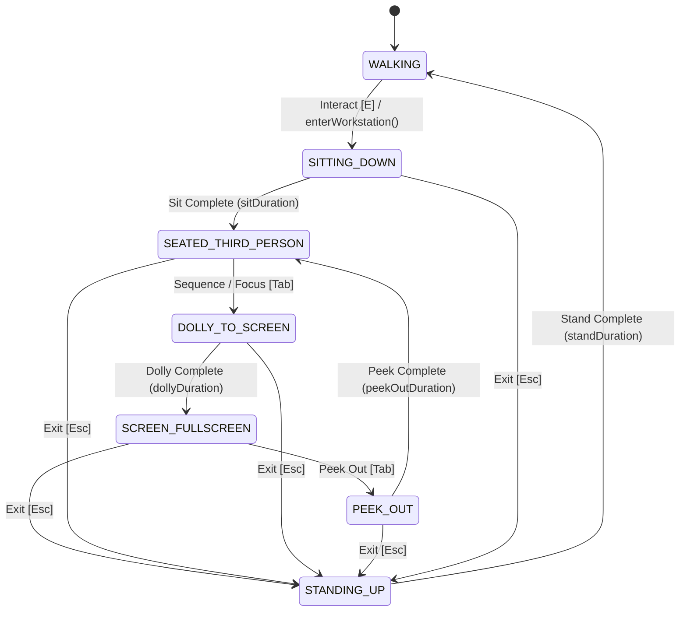
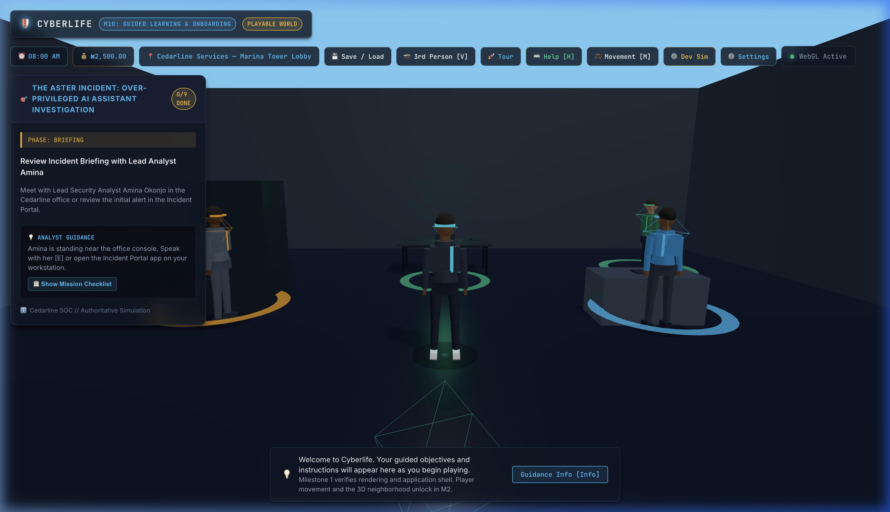
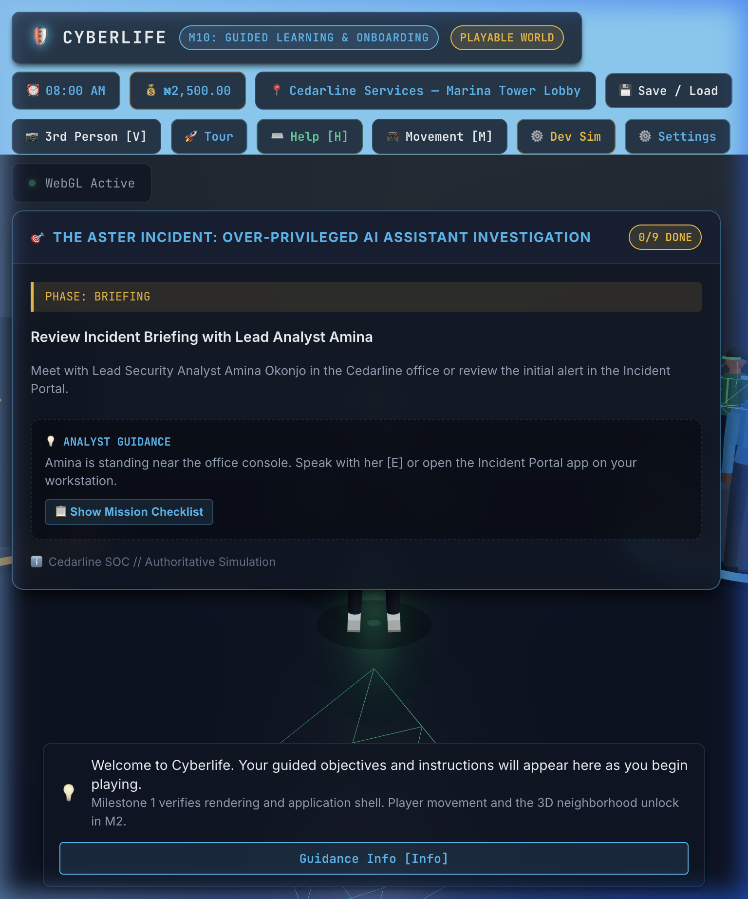
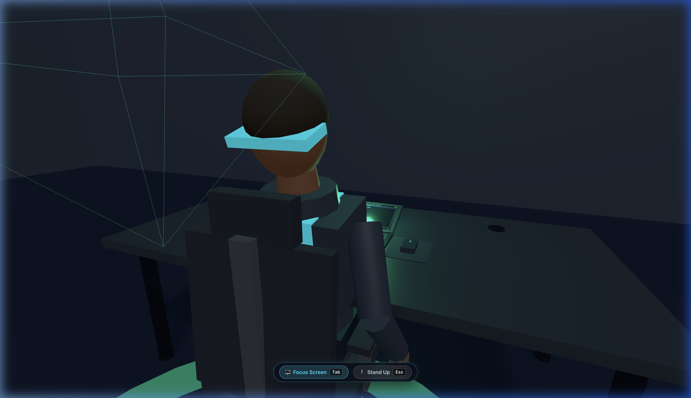
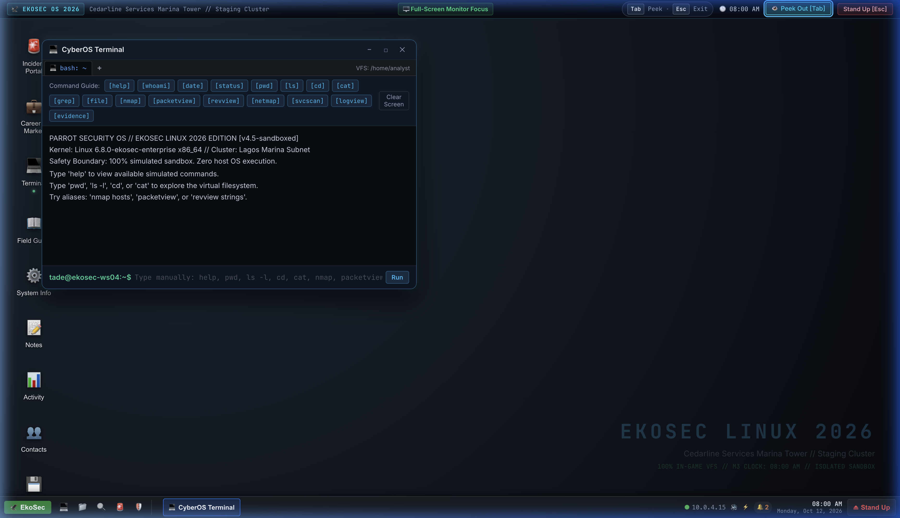
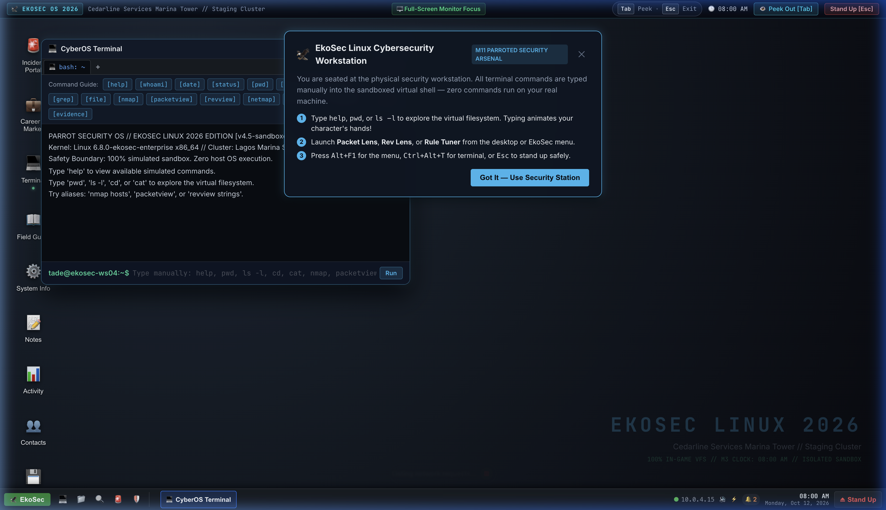
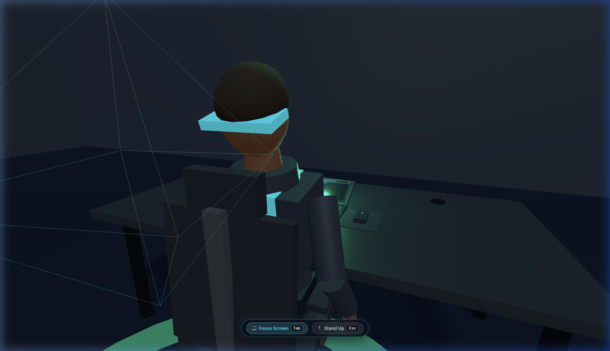
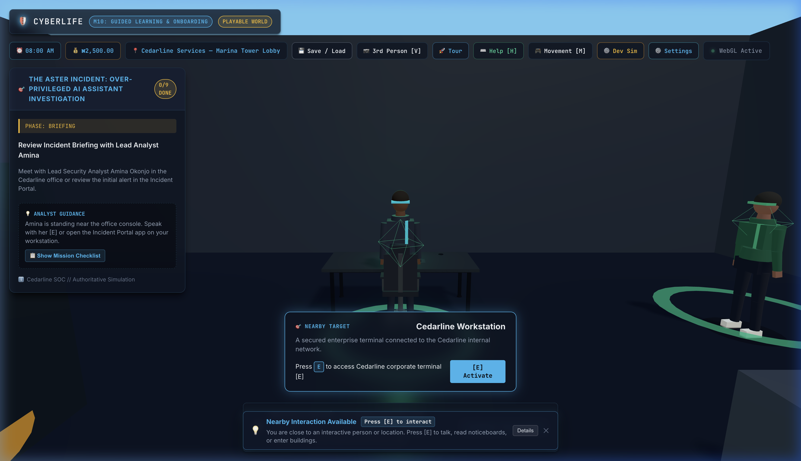

# Workstation Camera States & Screen Transition Architecture

## Overview

Cyberlife features a continuous, cinematic camera flow when interacting with physical cybersecurity workstations:

$$\text{WALKING} \xrightarrow{\text{sit down}} \text{SEATED\_THIRD\_PERSON} \xrightarrow{\text{dolly in}} \text{SCREEN\_FULLSCREEN} \underset{\text{Tab / Focus}}{\overset{\text{Tab / Peek}}{\rightleftharpoons}} \text{SEATED\_THIRD\_PERSON} \xrightarrow{\text{Esc / Stand}} \text{WALKING}$$

This document details the presentation architecture, state machine, anchor definitions, screen rendering pipeline, configuration parameters, and the procedure for registering new 3D workstation assets.

---

## 1. State Machine & Transition Diagram

The camera is governed by `WorkstationCameraStateMachine` (`src/presentation/world/camera/WorkstationCameraStates.ts`). All transitions are **strictly time-based** using `deltaTime` and smooth **cubic ease-in-out** acceleration/deceleration.



### The 7 Camera States

| State | Description | Camera Framing | Input State | Overlay Opacity |
| :--- | :--- | :--- | :--- | :--- |
| `WALKING` | Standard 3rd-person or 1st-person exploration | Free orbit / follow camera, $FOV = 65^\circ$ | Player movement & look active | $0.0$ (unmounted) |
| `SITTING_DOWN` | Easing transition from approach position to seated pose | Interpolating position, look target, and FOV | Blocked | $0.0$ |
| `SEATED_THIRD_PERSON` | Over-the-shoulder framing, character seated at desk, hands on keyboard, screen glowing | `CAMERA_SEATED_TP` or `CAMERA_SEATED_FP`, $FOV = 65^\circ$ | Workstation peek controls active | $0.0$ (hidden, session preserved) |
| `DOLLY_TO_SCREEN` | Smooth zoom towards laptop monitor screen quad | Interpolating from seated framing to `CAMERA_SCREEN`, $FOV \to 52^\circ$ | Blocked | Crossfades $0.0 \to 1.0$ starting at 70% progress |
| `SCREEN_FULLSCREEN` | Camera locked on screen quad, edge-to-edge UI active | `CAMERA_SCREEN`, $FOV = 52^\circ$ | Virtual OS shell active | $1.0$ (interactive) |
| `PEEK_OUT` | Easing back from screen quad to over-the-shoulder seated framing | Interpolating from `CAMERA_SCREEN` to seated framing, $FOV \to 65^\circ$ | Blocked | Fades $1.0 \to 0.0$ |
| `STANDING_UP` | Easing back from workstation to walking exploration framing | Interpolating from current framing to walking camera | Blocked | $0.0$ |

---

## 2. Configuration & Timing

All timing parameters are configured centrally in `src/presentation/world/worldConfig.ts` under `WORLD_CONFIG.camera.workstation`:

```typescript
workstation: {
  sitDuration: 0.8,              // Duration in seconds to sit down
  dollyDuration: 0.7,            // Duration in seconds to dolly into screen
  peekOutDuration: 0.6,          // Duration in seconds to peek back out
  standDuration: 0.7,            // Duration in seconds to stand up
  reducedMotionDuration: 0.25,   // Accelerated duration when Reduce Motion is enabled
  screenFov: 52,                 // Narrower, cinematic FOV focused on screen
  screenFillFraction: 0.85,      // Fraction of viewport width the physical screen fills
  overlayCrossfadeStart: 0.70,   // Progress fraction of dolly where DOM overlay fades in
}
```

### Easing Function

Transitions use a symmetric $C^1$-continuous cubic ease-in-out function (`easeInOutCubic`):

$$f(t) = \begin{cases} 4t^3 & \text{if } t < 0.5 \\ 1 - \frac{(-2t + 2)^3}{2} & \text{if } t \ge 0.5 \end{cases}$$

This ensures zero acceleration jerks at start and end points, preventing disorientation or visual popping.

---

## 3. Workstation Anchors System

Workstation coordinates are managed via typed anchor sets (`src/presentation/world/WorkstationAnchors.ts`) rather than hardcoded vectors:

```typescript
export interface WorkstationAnchorSet {
  SEAT_ANCHOR: SeatAnchor;        // Position and facing yaw for seated character
  SCREEN_QUAD: ScreenQuad;        // Center, normal vector, width, height of screen mesh
  KEYBOARD_ANCHOR: PointAnchor;   // Center of keyboard for hand positioning
  MOUSE_ANCHOR: PointAnchor;      // Center of mouse pad for hand positioning
  CAMERA_SEATED_TP: CameraFraming;// Over-the-shoulder seated third-person framing
  CAMERA_SEATED_FP: CameraFraming;// Seated eye-level first-person framing
  CAMERA_SCREEN: CameraFraming;   // Derived framing for fullscreen monitor
}
```

### Mathematical Screen Framing Derivation

`CAMERA_SCREEN` is computed automatically from `SCREEN_QUAD` via `deriveCameraScreen()`:

$$\text{distance} = \frac{\text{quad.width}}{2 \cdot \text{fillFraction} \cdot \text{aspectRatio} \cdot \tan\left(\frac{\text{screenFOV}}{2}\right)}$$

$$\text{cameraPosition} = \text{quad.center} + \text{normal} \cdot \text{distance}$$

$$\text{lookTarget} = \text{quad.center}$$

This guarantees that any screen mesh with known dimensions will occupy precisely 85% of the viewport width with no perspective distortion.

---

## 4. How to Add a New Workstation Asset

When importing a new GLB workstation model (e.g., custom executive desk, dual monitors, or modular cubicle):

1. **In Blender / Maya / DCC Tool:**
   Add empty locator objects as children of the workstation root:
   - `SEAT_ANCHOR`: Placed where character sits (rotation defines facing direction).
   - `SCREEN_QUAD`: Placed at center of monitor display, local +Z pointing out of screen face.
   - `KEYBOARD_ANCHOR`: Placed on keyboard surface.
   - `MOUSE_ANCHOR`: Placed on mouse surface.

2. **Loading Anchors in Code:**
   Pass the loaded GLTF hierarchy to `loadWorkstationAnchorsFromObject(gltf.scene)`:

   ```typescript
   import { loadWorkstationAnchorsFromObject } from '@/presentation/world/WorkstationAnchors';

   const customAnchors = loadWorkstationAnchorsFromObject(loadedGltfScene);
   cameraController.getStateMachine().setAnchors(customAnchors);
   ```

   Any omitted empties will automatically fall back to verified default values.

---

## 5. In-World Screen Rendering (`ScreenRenderer`)

While peeked out or standing near the computer, the physical 3D laptop monitor displays a live, active representation of the virtual desktop:

- **Resolution:** $1280 \times 800$ internal canvas (16:10 aspect ratio).
- **Texture Setup:** `THREE.SRGBColorSpace`, $8\times$ anisotropic filtering, hardware mipmaps (`LinearMipmapLinearFilter`).
- **Material:** `MeshStandardMaterial` with emissive intensity of $1.4$, casting ambient light onto the desk, keyboard, and avatar face.
- **Throttling:** Updates at $12\text{ fps}$ (83 ms interval) only when visible in frustum, pausing when off-screen to conserve GPU cycles.
- **State Synchronization:** Reflects open window titles, top status bar, active wallpaper color, and the last 15 lines of sandboxed terminal output.

---

## 6. UX Controls & Settings

### Keyboard Shortcuts
- **`Tab`**: Toggles between `SCREEN_FULLSCREEN` and `SEATED_THIRD_PERSON` (Peek Out / Focus Screen). The virtual desktop session, running processes, and terminal history remain completely mounted and intact.
- **`Esc`**: Safely stands up from any state, returning to `WALKING` with full movement and camera controls restored.

### User Settings Modal (`⚙️ Settings`)
Located in the main HUD status bar and persisted to `localStorage`:
- **`Reduce camera motion`**: Shortens all transition durations to $0.25\text{ s}$ and eliminates FOV reduction.
- **`Skip sit-down animation after first time`**: Once the player has sat down once during a play session, subsequent workstation interactions dolly directly into the screen.
- **`Show key hints`**: Toggles subtle on-screen keyboard shortcut pill in the desktop top panel.

---

## 7. State Flow Visual Verification

| State | Visual Framing |
| :--- | :--- |
| **1. WALKING** |  |
| **2. SITTING_DOWN** |  |
| **3. SEATED_THIRD_PERSON** |  |
| **4. DOLLY_TO_SCREEN** |  |
| **5. SCREEN_FULLSCREEN** |  |
| **6. PEEK_OUT** |  |
| **7. STANDING_UP** |  |
