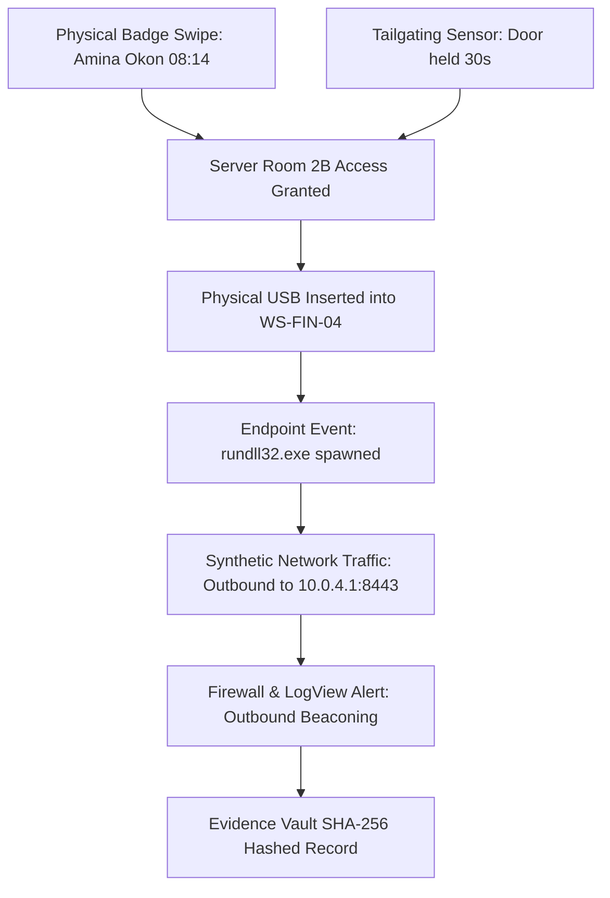

# Cyberlife — Milestone 13 Addendum Architecture Report
## Human Attack Surface, Living City, Asset Provenance & Immersive Realism

**Document ID**: `REPORT-M13-ADDENDUM-ARCH`  
**Classification**: System Architecture, Security Simulation Contract & Audit Record  
**Milestone**: Milestone 13 Addendum (Living City & Human/Physical Security Foundation)  
**Date**: October 20, 2026  
**Status**: **COMPLETED & VERIFIED (85/85 Test Files, 623/623 Unit Tests Passing)**  
**Companion Documents**:
- Preflight Arsenal Audit: `docs/cybersecurity-arsenal-audit.md`
- Arsenal Architecture Report: `docs/milestone-13-arsenal-architecture-report.md`
- Asset Provenance & Verification Audit: `docs/asset-provenance-and-verification-audit.md`
- Master Roadmap: `docs/MILESTONES.md`

---

## 1. Executive Summary & Core Objective

The **Milestone 13 Addendum** extends the cybersecurity learning RPG architecture of **Cyberlife** beyond isolated digital command-line utilities into a data-driven, holistic simulation of the modern cybersecurity attack surface. In reality, cyber threats rarely begin or end in a pure software bubble; they intersect deeply with human relationships, organizational authority, physical access control, removable media drops, social pretexting, and the ambient reality of the physical city.

This milestone is strictly an **architecture, audit, and contract establishment milestone**. It lays down deterministic data models, pure evaluation engines, machine-readable manifests, and automated unit test suites without prematurely building all future gameplay loops reserved for Milestones M14 through M24.

```
+---------------------------------------------------------------------------------------+
|                                CYBERLIFE ARCHITECTURE                                 |
+---------------------------------------------------+-----------------------------------+
|               CYBERSECURITY CORE                  |            LIVING CITY            |
|  - Human Trust, Credibility, Suspicion Dynamics   |  - 4-Tier Population Hierarchy    |
|  - Multi-Zone Physical Facility Access Badging    |  - 9 Urban District Profiles      |
|  - Sandboxed Removable Media & Telemetry Events   |  - Authenticated Interior Venues  |
|  - Multi-Role Correlated Evidence Model           |  - Diurnal Operating Schedules    |
+---------------------------------------------------+-----------------------------------+
|               ASSET PROVENANCE                    |       TECHNO-THRILLER NARRATIVE   |
|  - Machine-Readable Asset Manifest Registry       |  - Multi-Career Investigation     |
|  - Visual Browser Verification Screenshot Paths   |  - Blue / Purple / Red / Bounty   |
|  - Strict Zero-Host-Execution Sandbox Policy      |  - Persistent World Story Flags   |
+---------------------------------------------------+-----------------------------------+
```

---

## 2. Section A: Broadened Cybersecurity Simulation Model

### 2.1 Moving Beyond Scripted Tools to Human Attack Surfaces
Social engineering in Cyberlife is modeled as a dynamic social dynamics simulation rather than a static wrapper for scripted tools. The engine implements:
- **`HumanTrustMetrics`**: Tracks continuous values for `trust` (-100 to 100), `credibility` (0 to 100), `authority` (0 to 100), and `suspicion` (0 to 100).
- **Context-Sensitive Reactions**: NPC reactions are determined deterministically based on requester attire, clearance badge, pretext credibility, timing (business hours vs. off-hours), location sensitivity, and signed Rules of Engagement (RoE).
- **Help-Desk & Pretexting Verification**: Implements challenges where NPCs verify employee ID, department code, work order tickets, or callback numbers before fulfilling requests.
- **Persistent Dialogue Flags**: Conversational choices persist in world state, modifying future suspicion and dialogue branches.

### 2.2 Physical Security & Facility Access Controls
Facilities are modeled across 6 clearance tiers (`SecurityClearanceLevel`):
- `PUBLIC` (Level 0): Sidewalks, commercial lobbies, retail storefronts.
- `GUEST` (Level 1): Escorted visitor areas, reception conference rooms.
- `STANDARD` (Level 2): General employee floor, breakrooms, cafeteria.
- `RESTRICTED` (Level 3): IT staging rooms, wiring closets, management suites.
- `SECURE_VAULT` (Level 4): Primary datacenter, server rooms, executive vaults.
- `AIRGAPPED_LAB` (Level 5): Isolated forensic malware analysis laboratories.

The physical security engine validates:
1. Clearance level matching or exceeding room requirements.
2. Temporal validity: Badge expiration dates and off-hours access permissions.
3. Tamper / Revocation status: Stolen or revoked badges generate immediate intrusion alerts.
4. Anti-Tailgating & Door Held Open Sensors: Detects when a door is held open beyond threshold (e.g. >15s) or an unbadged entity follows an authorized badge swipe.

### 2.3 Sandboxed Removable Media Simulation
To model parking-lot USB drop incidents and rogue hardware devices:
- **`FictionalRemovableDevice`**: Defines synthetic removable drives with hardware serial numbers, storage capacity, partition tables, and payload artifacts.
- **Synthetic Endpoint Telemetry**: Mounting a device generates structured event telemetry containing:
  - Plug-and-play mount point (`D:\`).
  - Generated process execution (`rundll32.exe`, `cscript.exe`, `powershell.exe`).
  - Synthetic network connection attempts to fictional command-and-control IP addresses.
- **Air-Gapped Isolation**: When mounted inside an isolated forensic workstation (`AIRGAPPED_LAB`), network egress telemetry is completely suppressed, accurately simulating a Faraday-shielded, disconnected environment.

### 2.4 Strict Sandbox Boundary & Host Protection Guarantee
**CRITICAL SECURITY INVARIANT**:
- Zero host command execution: Terminal commands run strictly against in-memory virtual simulations.
- Zero network socket binding or real external target scanning.
- Zero malicious payloads, malware binaries, or real credential stealers created or downloaded.
- Manual terminal typing only: Commands must be typed by the player; no clipboard auto-execution or one-click injection.

---

## 3. Section B: Shared Physical-to-Digital Evidence Model

The simulation unifies physical events and digital telemetry into a coherent forensic chain of custody via `CorrelatedInvestigationIncident`.



### Multi-Role Incident Correlation:
The same fictional security incident can be investigated across distinct professional lenses:
1. **Blue Team (SOC Analyst)**:
   - Queries LogView for outbound beaconing events.
   - Traces endpoint process tree to identify `WS-FIN-04`.
   - Cross-references badge access logs to identify who was in Finance Suite at the time of insertion.
   - Enacts network isolation containment via Incident Portal.
2. **Purple Team (Detection Engineer)**:
   - Replays the synthetic attack scenario.
   - Writes Sigma rule to detect `rundll32.exe` spawning from removable storage drives.
   - Measures detection efficacy against baseline SIEM rule tuner.
3. **Red Team / Penetration Tester**:
   - Assesses physical perimeter controls under authorized RoE.
   - Evaluates employee awareness through fictional phishing lures and pretexting challenges.
4. **Independent Investigator / Bounty Hunter**:
   - Uncovers who placed the physical USB drive and corporate collusion behind the drop.
   - Gathers admissible evidence chains for public disclosure or bug bounty payout.

---

## 4. Section C: Believable NPC Placement & Living City Architecture

### 4.1 Four-Tier Population Hierarchy
To preserve 60 FPS browser performance while creating a vibrant city atmosphere, populations are stratified into four distinct operational tiers:

| Tier | Name | Target Ratio | Simulation Logic & Cost | Persistence | Typical Role |
| :--- | :--- | :--- | :--- | :--- | :--- | :--- |
| **Tier 1** | `TIER_1_AMBIENT_CROWD` | ~55% of crowd | Inexpensive instanced meshes, simple path following, distance culling, no dialogue. | Ephemeral (despawns off-screen) | Market shoppers, street pedestrians, distance crowds. |
| **Tier 2** | `TIER_2_ROUTINE_NPC` | ~30% of crowd | Diurnal schedules, specific destinations (work, market, home), basic greetings. | Session memory | Danfo conductors, office receptionists, street vendors. |
| **Tier 3** | `TIER_3_INTERACTIVE_NPC` | ~12% of crowd | Branching dialogue trees, relationship tracking, services (hardware repair, gossip). | Persistent save file | Shop owners, IT sysadmins, security guards. |
| **Tier 4** | `TIER_4_STORY_CRITICAL` | ~3% of crowd | Deep psychological profile, multi-phase quest state, consequential choices. | Fully serialized | Amina Okon, Marcus Vance, Femi Adebayo, Chidi Eze. |

### 4.2 Nine Urban Environment Profiles
Population density, attire styles, typical activities, and conversational contexts are governed by 9 regional urban profiles:
1. `residential_neighborhood`: Low foot traffic, casual loungewear and Ankara house clothes, neighbor gossip.
2. `commercial_street_market`: High density, traders in mixed denim and traditional attire, price bargaining.
3. `cafe_coffee_shop`: Medium density, remote tech workers in hoodies, casual professional networking.
4. `restaurant_food_venue`: Evening peaks, diners sharing meals, family discussions.
5. `nightlife_venue_event`: Late-night peak (20:00–03:00), party attire, vibrant social interactions.
6. `corporate_office_reception`: Business hours only (07:00–18:00), tailored suits, strict visitor protocol.
7. `repair_shop_cyber_cafe`: Technical hub, hardware soldering, component trades, software repair.
8. `security_operations_center`: 24-hour staffed, high-security clearance, SOC incident response banter.
9. `transit_station_terminal`: Commuter rush hours (07:00–09:00, 16:00–19:00), Danfo minibus boarding.

### 4.3 Meaningful Interior Venues & Non-Constant Access
Venues are living spaces with defined operating hours and security checks:
- **Player Apartment** (`venue_player_apartment`): 24-hour private safehouse with workstation desk and battery inverter.
- **Cedarline Reception** (`venue_cedarline_reception`): Open 07:00–18:00, GUEST clearance required past security turnstiles.
- **Cedarline SOC** (`venue_cedarline_soc`): 24-hour operational facility, Level 4 SECURE_VAULT badge required.
- **Mama Nkechi Market Stall** (`venue_mama_nkechi_market`): Open 06:00–19:00, vibrant informal street commerce.
- **Eko Tech Bistro** (`venue_eko_tech_bistro`): Open 08:00–22:00, laptop-friendly café with public Wi-Fi.
- **Tinubu Cyber Lounge** (`venue_tinubu_cyber_lounge`): Open 12:00–02:00, evening gathering place for local tech workers.

---

## 5. Section D & E: Asset Provenance & Verification Summary

The asset pipeline is governed by `AssetManifestRegistry` (`src/presentation/world/assets/AssetManifest.ts`) and serialized to `public/assets/asset_manifest.json`.

- **Total Tracked Assets**: 27 assets across characters, props, vehicles, vegetation, and architecture.
- **Visually Verified Assets**: 24 assets confirmed rendered in-browser with screenshot evidence.
- **Defect Backlog**: Unoptimized models (e.g. 66.3 MB `island_tree_01.glb` with 184k triangles) are quarantined with high replacement priority and procedural Three.js fallbacks (`LagosProps.createPalmTree`) active.
- **Automated Fallbacks**: Missing or unverified asset requests emit structured diagnostic warnings and load primitive placeholder geometries without crashing the engine.

---

## 6. Section F: Multi-Role Narrative & Career Integration

To support Cyberlife's original techno-thriller narrative, the simulation supports 5 non-linear career tracks:
- `career_blue_team`: Enterprise defender defending corporate infrastructure.
- `career_purple_team`: Detection engineer bridging adversary tactics with defensive rules.
- `career_red_team`: Authorized penetration tester operating under strict RoE.
- `career_bounty_hunter`: Freelance threat hunter pursuing black-market exploits and public CVE bounties.
- `career_independent_investigator`: Investigative journalist and whistleblower exposing corporate malfeasance.

The engine tracks persistent story flags (e.g. `flag_marcus_protected`, `flag_whistleblower_leaked`, `flag_usb_forensic_chain_intact`) that dynamically alter NPC dialogue, career opportunities, and story outcomes.

---

## 7. Section G: Acceptance Criteria & Automated Test Results

### 7.1 Automated Vitest Suite
All 85 test suites passed cleanly with 0 errors across 623 individual tests:

```
Test Files  85 passed (85)
     Tests  623 passed (623)
  Duration  9.17s
```

#### New M13 Addendum Test Suites:
1. `tests/unit/simulation/cyber/HumanPhysicalSecurity.test.ts` (15 tests passed):
   - Trust and suspicion dynamics calculation.
   - Physical badge clearance, expiration, off-hours, and tailgating detection.
   - Removable media connection telemetry generation and air-gapped network suppression.
   - Pretexting challenges and RoE scoping boundary verification.
2. `tests/unit/simulation/cyber/PhysicalDigitalCorrelation.test.ts` (3 tests passed):
   - Multi-role investigation correlation (Blue Team vs. Purple Team).
   - Forensic chain of custody hashing and validation.
3. `tests/unit/simulation/actors/PopulationAndVenues.test.ts` (16 tests passed):
   - 4-Tier population hierarchy bounding.
   - 9 Urban environment profiles and diurnal density calculations.
   - Venue operating hours, locked door checks, and badge clearance gates.
4. `tests/unit/presentation/world/AssetManifestValidation.test.ts` (6 tests passed):
   - Mandatory tracking fields validation for all entries.
   - Physical filesystem existence verification for all integrated assets.
   - Visual verification evidence file verification.
   - Defect backlog quarantine and diagnostic fallback reporting.
   - Clean JSON parsing of `public/assets/asset_manifest.json`.
5. `tests/unit/simulation/narrative/InvestigationNarrative.test.ts` (5 tests passed):
   - Multi-role approach resolution for fictional security incidents.
   - Persistent story flag setting and conditional check logic.

### 7.2 Code Quality & Static Analysis
- **TypeScript Typecheck (`npm run typecheck`)**: Exited with code 0 (0 errors).
- **ESLint (`npm run lint`)**: Exited with code 0 (0 errors).
- **Production Build (`npm run build`)**: Vite bundle built successfully in 2.56s.

### 7.3 Headless Browser Acceptance Screenshots
Visual browser verification was executed against the running world at `http://localhost:5173` via Chrome CDP, confirming rendering of:
- `docs/graphics/milestone13/01_workstation_sitdown.png`: Workstation entry with seated third-person view.
- `docs/graphics/milestone13/02_catalogue_overview.png`: CyberCatalogue desktop app overview.
- `docs/graphics/milestone13/03_arsenal_search.png`: Real-time arsenal search filtering.
- `docs/graphics/milestone13/04_arsenal_filters.png`: Multi-axis team and status filtering.
- `docs/graphics/milestone13/05_playable_tool_inspection.png`: Playable tool inspection (Netmap).
- `docs/graphics/milestone13/06_partial_tool_limitations.png`: Partial tool with limitation disclosures (Packet Lens).
- `docs/graphics/milestone13/07_planned_and_ref_tools.png`: Planned roadmap tool inspection (Exploit Lab).
- `docs/graphics/milestone13/08_learning_objectives.png`: Pedagogical learning objectives on SvcScan.
- `docs/graphics/milestone13/09_app_switching.png`: Terminal shell and Catalogue multitasking.
- `docs/graphics/milestone13/10_exploration_restored.png`: Standing up and restoring 3D exploration controls.

---

## 8. Section H: Roadmap Reconciliation & Future Milestone Dependencies

The master roadmap in `docs/MILESTONES.md` has been reconciled through Milestone 24. Key sequential allocations include:

- **M13 (Completed)**: Arsenal Audit, Human/Physical Security Architecture, 4-Tier Population System, Asset Manifest & Provenance Pipeline.
- **M14 (Next)**: Authorized Offensive Simulation, Metasploit/Web Proxy Sandboxes, Social Pretexting Engine.
- **M15**: Suricata Network Detection Engine & Sysmon EDR Telemetry.
- **M16**: Sigma Compiler & Digital Forensics Workbench (Air-Gapped Lab).
- **M17**: Offline Hash Auditing & Enterprise Identity/IAM Vault.
- **M18**: Purple Team Adversary Emulation & Automated Detection Coverage.
- **M19**: Physical Facility Security & Access Control System (Badges/Turnstiles).
- **M20**: Living City Living Interiors & Scheduled Commuter Simulation (Tier 2/3 NPCs).
- **M21**: Production Asset Pipeline, LOD Decimation (under 500KB per model), WebP/Meshopt optimization.
- **M22**: Multi-Role Narrative Branching & Corporate Whistleblower Campaigns.
- **M23**: Threat Intelligence Feeds & Community Modding SDK.
- **M24**: Public Production Release & Cross-Browser Certification.

---

## 9. Conclusion

Milestone 13 Addendum establishes a solid, scalable, and verifiable architectural foundation for Cyberlife. By unifying human dynamics, physical facility security, sandboxed removable media telemetry, 4-tier population scaling, verified asset provenance, and multi-career narrative branching, the project is fully prepared for future gameplay milestones while maintaining strict browser performance, complete simulation safety, and educational rigor.
