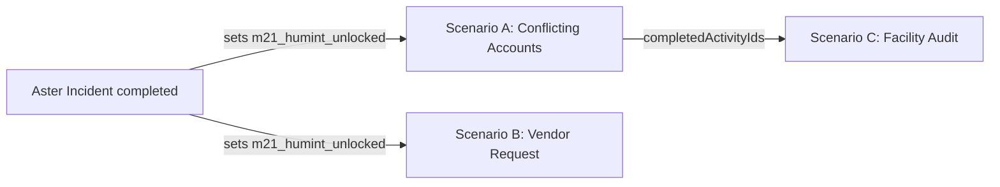

# Cyberlife Milestone 21 — Human Intelligence, Social Investigation & Physical Security Report

**Milestone:** M21 — Human Intelligence, Social Interactions, Investigation & Physical Security  
**Date:** October 2026  
**Status:** **IN PROGRESS** — simulation layer complete & tested; player-facing UI not yet implemented  
**Test Suite Status:** 57 M21-specific tests passing; 1011/1011 total tests passing across 124 files; 0 regressions  
**TypeScript Status:** Clean (`tsc --noEmit` exited 0)  
**Headless Browser Screenshots:** None yet — there is no M21 screen to capture (see §8)

---

## 1. Executive Summary

M21 extends Cyberlife beyond computer-based security into human intelligence (HUMINT): interviewing
witnesses, weighing testimony against technical records, recognising social-engineering attempts, and
running an authorized physical-security assessment.

The full domain model, command set, scenario content, activity integration and persistence hook are
implemented as pure TypeScript in `src/simulation/humanIntel/` and are covered end-to-end by unit tests.

**What is not done:** no desktop app or HUD panel exposes these commands yet. The three scenarios can
currently only be driven by dispatching commands to the engine (tests, dev tooling). Activity objectives
already refer to a "Human Intel panel" that still needs to be built.

---

## 2. Files and Major Systems Changed

### Domain Layer (`src/simulation/humanIntel/`) — new
| File | Purpose |
|---|---|
| `types.ts` | Domain contracts: observations, interview sessions, witness statements, evidence comparisons, conclusions, social-engineering evaluations, assessment findings/reports, `HumanIntelState` slice and `createInitialHumanIntelState()`. |
| `scenarioData.ts` | Authored content for Scenarios A–C: interview questions, vendor message & decision options, inspectable objects, expected findings, Scenario A evidence items. |
| `humanIntelCommandHandler.ts` | 10 pure command handlers plus their command type definitions. |

### Adapter Layer
- `src/simulation/activities/adapters/M21HumanIntelAdapter.ts` — new. Marks M21 activity objectives complete from `humanIntel` state and world flags. Exported via `adapters/index.ts` and called from `syncAllActivitiesWithAdapters()`.

### Core Simulation Integration — modified
- `core/types.ts`, `core/initialState.ts` — optional `humanIntel` slice on `SimulationState`, initialised empty.
- `commands/types.ts`, `commands/commandHandler.ts` — the 10 M21 commands added to the `SimulationCommand` union and dispatch switch.
- `activities/activityCatalogue.ts` — three authored M21 activities; the Aster Incident reward now sets `m21_humint_unlocked`.
- `activities/types.ts`, `activities/activityCommandHandler.ts` — adapter wiring.
- `application/persistence/SaveManager.ts` — older saves without a `humanIntel` slice are backfilled on load.

### Tests
- `tests/unit/simulation/humanIntel/M21HumanIntel.test.ts` — new, 57 tests (see §7).

### Dev dependency
- `puppeteer-core` added to `devDependencies` for headless screenshot verification (§8).

---

## 3. Command Set

| Command | Effect |
|---|---|
| `StartInterview` | Opens an interview session with an NPC for an activity. Scenario A also adds the badge-log evidence to the narrative evidence vault and sets `m21a_badge_log_reviewed`. |
| `AskInterviewQuestion` | Records a witness statement (with reliability rating), applies flags and relationship change. Enforces flag/relationship gates and blocks repeats. |
| `PresentEvidenceToNpc` | Presents vault evidence during an active interview. |
| `ConcludeInterview` | Closes the session, records trust before/after, sets `m21_interview_completed_<npc>_<activity>`. |
| `InspectWorldObject` | Records an observation of an inspectable object; idempotent per object/activity. |
| `CompareEvidenceWithTestimony` | Player gives a verdict on a statement vs. technical evidence; graded against ground truth. |
| `SubmitM21Conclusion` | Player submits an investigative conclusion; graded, with consequence flags. |
| `EvaluateSocEngDecision` | Records the player's response to the vendor request; rating, reputation change, consequence flags. |
| `RaiseAssessmentFinding` | Raises a formal physical-security finding linked to observations. |
| `SubmitPhysicalAssessmentReport` | Compiles findings into a risk-rated report, scored against expected findings. |

All handlers are pure: they return a new frozen state and events, and return a typed failure
(`NPC_NOT_FOUND`, `DIALOGUE_CONDITION_NOT_MET`, `ITEM_NOT_FOUND`, `INVALID_COMMAND`, …) instead of throwing.

---

## 4. Authored Scenarios

### Scenario A — The Server Room Discrepancy (`act_m21_conflicting_accounts`)
- **Unlock:** `m21_humint_unlocked`, set when the Aster Incident is completed.
- **Witnesses:** `npc_marcus` (junior infra admin, "Tobi A." in the evidence text) and `npc_amina` (lead security analyst, "Blessing" in dialogue).
- **Flow:** Marcus denies being in Room 4B → the badge log shows his credential at 19:47 → when confronted he admits lending his badge to Femi → Amina confirms the badge-sharing policy breach.
- **Graded steps:** comparing Marcus's alibi with the badge log (correct verdict: `CONTRADICTED`); final conclusion (`conc_a_badge_lending_policy_breach` = `SUPPORTED`; `conc_a_marcus_insider_threat` = `CONTRADICTED`, sets `m21a_premature_accusation`).
- **Reward:** ₦3,500 · 180 XP · 40 reputation · unlocks Scenario C.

### Scenario B — Unusual Vendor Access Request (`act_m21_vendor_request`)
- **Unlock:** `m21_humint_unlocked`.
- **Content:** A spoofed "Telekron Power Systems" email with four red flags (unregistered domain, unescorted access, admin credentials by email, artificial urgency).
- **Decisions:** five options rated from `EXCELLENT` (verify-and-deny, report to SOC) to `CRITICAL_FAILURE` (approve without verifying, −30 reputation).
- **Reward:** ₦2,000 · 120 XP · 30 reputation.

### Scenario C — Cedarline Visitor Management Audit (`act_m21_facility_audit`)
- **Unlock:** Scenario A completed. 4-hour deadline.
- **Content:** 5 inspectable objects (sign-in sheet, unattended badge printer, propped door, rotated CCTV camera, escort-policy poster) and 4 expected findings.
- **Scoring:** report rating depends on how many expected findings are matched (≥75% / ≥50% thresholds). The overall risk rating is the highest finding severity.
- **Reward:** ₦5,000 · 250 XP · 60 reputation.

---

## 5. Unlock & Progression Chain

Two gate flags were previously never set by any game code (tests worked around them by setting the
flags by hand). Both are now set by real gameplay, and covered by the "Reachability" tests:
- `m21_humint_unlocked` — Aster Incident reward.
- `m21a_badge_log_reviewed` — `StartInterview` for Scenario A.

---

## 6. Simulation Safety Boundary

- 100% in-memory and deterministic in grading. No host commands, no network calls, no real credentials.
- All people, companies, domains (`*.example.sim`) and phone numbers are fictional.
- Physical assessment is framed as **authorized**, with an explicit scope and authorization reference required on the report.
- Social-engineering content trains *recognition and correct response*, not how to carry out an attack.

---

## 7. Test Coverage (`M21HumanIntel.test.ts`, 57 tests)

| Suite | Covers |
|---|---|
| Catalogue & Initial State | Activity definitions, objective counts, prerequisites, deadline, initial slice. |
| Reachability from normal gameplay | M21 locked at start; Aster reward unlocks A/B; every interview-question gate flag is settable. |
| Scenario A | Sessions, evidence injection, gated/duplicate questions, Femi lead, comparison grading, conclusions, adapter sync. |
| Scenario B | All five decisions, ratings, reputation, consequence flags, adapter sync. |
| Scenario C | Inspection idempotency, findings, report scoring and risk rating, adapter sync. |
| Command Handler Dispatch | All M21 commands route through the main `commandHandler`. |
| Scenario Data Integrity | Unique IDs, cross-references, required fields. |

Run: `npx vitest run tests/unit/simulation/humanIntel/M21HumanIntel.test.ts`

---

## 8. Known Gaps (blocking COMPLETED status)

1. **No player-facing UI.** No desktop app or HUD panel reads `state.humanIntel` or dispatches M21 commands. A `HumanIntelApp` (interviews & comparison, vendor decision, facility audit) needs to be built and registered in `DesktopShell`.
2. **No headless screenshots.** Blocked by (1). Planned output: `docs/graphics/milestone21/`.
3. **Name mismatch.** Scenario text uses "Tobi"/"Blessing" for `npc_marcus`/`npc_amina`, whose NPC profiles use different names. Should be aligned.
4. **No save/load roundtrip test** specifically for `humanIntel` (the backfill on load is in place).

---

## 9. Acceptance Criteria Status

See `docs/ACCEPTANCE_CRITERIA.md` → *Milestone M21*.
