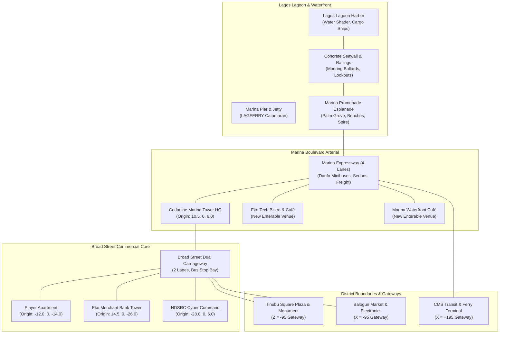

# Cyberlife — World Expansion Specification: District 1
## Broad Street Commercial Corridor & Marina Promenade

> **Document Type**: Architectural Design Specification, Spatial Masterplan & Engineering Roadmap  
> **Target Path**: `docs/world/district-1-design.md`  
> **Status**: **STAGE A APPROVED ARCHITECTURAL SPECIFICATION**  
> **Scope**: Expansion of Outdoor World Slice from 76 × 76 m to 300 × 200 m (District 1)  
> **Setting**: Historic Commercial & Maritime Financial Core, Lagos Island, Nigeria (Circa 2026)  
> **Coordinate System**: Three.js Metric Cartesian ($X$: West–East, $Y$: Up, $Z$: South–North)  
> **Author**: Cyberlife Core World Systems Architecture  
> **Date**: October 23, 2026  

---

## 1. Executive Summary & Expansion Scope

In Stage A of the Cyberlife world expansion, the explorable outdoor environment transitions from a single bounded test slice of **76 × 76 m** ($\pm 38$ m) to **District 1: Broad Street & Marina**, a fully realized, continuous 3D metropolitan district spanning **300 m in width (West–East, $X = -100$ to $+200$) by 200 m in depth (South–North, $Z = -100$ to $+100$)**.

District 1 encapsulates the financial, legal, and mercantile heartbeat of Lagos Island, featuring:
1. **The Broad Street Commercial Canyon**: High-density bank headquarters, mid-rise colonial-era commercial blocks, zero-setback wall-to-wall storefronts, street-level airtime/POS kiosks, and dual-carriageway traffic.
2. **The Marina Waterfront Promenade**: A wide pedestrian esplanade alongside the open expanse of Lagos Lagoon, with concrete seawalls, mooring bollards, ferry jetties, and ocean cargo vessel vistas.
3. **The Maritime Expressway**: A 4-lane arterial coastal highway carrying dense Danfo commuter traffic, executive sedans, and logistics freight connecting Lagos Island to Victoria Island via Ring Road.
4. **Preserved Anchor Heritage**: Full preservation of all existing landmarks—the **Cedarline Marina Tower HQ**, the **Player Apartment (Broad Street 14)**, **Eko Merchant Bank**, and **NDSRC Cyber Command**—retaining their exact relative spatial coordinates ($X, Y, Z$) to guarantee **100% save file and quest navigation backward compatibility**.

---

## 2. Spatial Masterplan & Street Grid

The expanded district layout is organized along two orthogonal arterial corridors: **Broad Street** (running North–South from the historic interior toward the coast) and **Marina Boulevard** (running West–East along the lagoon waterfront).

### 2.1 ASCII Street Grid & District Layout

```
                        LAGOS ISLAND INTERIOR (DISTRICT 2 & 3 GATEWAYS)
                  ◄ West: Balogun Market (Z = -95)        North: Tinubu Square (X = 0, Z = -95) ►
   [-100, 0, -100]                                                                       [+200, 0, -100]
         ┌─────────────────────────┬───────────────────────┬─────────────────────────────────┐
         │ BALOGUN TRANSIT JUNCTION│ TINUBU SQUARE CIVIC   │ ODUNLAMI HISTORIC COMMERCIAL    │
         │ - Wholesale electronics │   PLAZA & MONUMENT    │ - Colonial Afro-Brazilian row   │
         │ - Street vendor stalls  │ - Community board     │ - Printing press offices        │
         │ - Mama Esther Provisions│ - Central fountain    │ - Cyber cafe & repair lab       │
         ├─────────────────────────┴───────────────┬───────┴─────────────────────────────────┤
         │                                         │ BROAD STREET COMMERICAL CANYON          │
         │                                         │ (2 Lanes: Northbound & Southbound)      │
         │ WEST COMMERCIAL FLANK                   │                                         │
         │ - NDSRC Cyber Command                   │ [X = -12, Z = -14]                      │
         │   [X = -28, Z = +6]                     │ 🏠 PLAYER APARTMENT (Broad St 14)       │
         │ - Telecom switching substation          │                                         │
         │ - Wall-to-wall storefronts              │ [X = 14.5, Z = -26]                     │
         │                                         │ 🏦 EKO MERCHANT BANK TOWER              │
         │                                         │                                         │
         │                                         │ [X = -4.8, Z = -28]                     │
         │                                         │ 🚌 DANFO BUS STOP & COMMUTER SHELTER    │
         ├─────────────────────────────────────────┼─────────────────────────────────────────┤
         │                                         │ [X = 10.5, Z = +6]                      │
         │                                         │ 🏢 CEDARLINE MARINA TOWER HQ            │
         │                                         │   (Ground Lobby & Level 4 SOC)          │
         │                                         │                                         │
         │                                         │ [X = 22, Z = +14]                       │
         │                                         │ ☕ EKO TECH BISTRO & WORK CAFÉ          │
         ├─────────────────────────────────────────┴─────────────────────────────────────────┤
         │ MARINA EXPRESSWAY (4-Lane Arterial Highway: 2 Eastbound, 2 Westbound, Z = 16 to 28)│
         │ ═════════════════════════════════════════════════════════════════════════════════ │
         │ MARINA WATERFRONT PROMENADE (Pedestrian Esplanade, Palms, Benches, Z = 30 to 42)  │
         │ - Eko Tech Spire Monument [X = 20, Z = 12]                                        │
         │ - Marina Lagoon Viewpoint [X = -15, Z = 12]                                       │
         │ - Marina Waterfront Café & Pier 4 [X = 75, Z = 38]                                │
   ──────┴───────────────────────────────────────────────────────────────────────────────────┴──────
         LAGOS LAGOON SEAWALL & HARBOR (Water Plane, Mooring Bollards, Ferries, Cargo Barges, Z > 42)
   [-100, 0, +100]                                                                       [+200, 0, +100]
```

### 2.2 Architectural Relationship & Mermaid Topological Map



---

## 3. Preservation of Existing Anchor Landmarks & Save Compatibility

A strict invariant of the District 1 masterplan is **Zero Coordinate Drift** for all existing gameplay, narrative, and persistence anchors. Moving the coordinate origin or shifting landmark positions would invalidate active save games, displace player avatars, break ongoing narrative triggers (e.g. Episode 1–3 investigative waypoints), and corrupt NPC pathfinding routes.

### 3.1 Anchor Coordinate Preservation Matrix

| Landmark / Entity | Existing Coordinate ($X, Y, Z$) | Expanded Coordinate ($X, Y, Z$) | Delta ($\Delta X, \Delta Y, \Delta Z$) | Compatibility Status |
| :--- | :---: | :---: | :---: | :--- |
| **Player Apartment Entrance** | `[-12.0, 0, -14.0]` | `[-12.0, 0, -14.0]` | `(0, 0, 0)` | **100% Locked / Zero Drift** |
| **Cedarline Marina Tower Entrance** | `[10.5, 0, 6.0]` | `[10.5, 0, 6.0]` | `(0, 0, 0)` | **100% Locked / Zero Drift** |
| **Eko Merchant Bank Entrance** | `[14.5, 0, -26.0]` | `[14.5, 0, -26.0]` | `(0, 0, 0)` | **100% Locked / Zero Drift** |
| **NDSRC Cyber Command Entrance** | `[-28.0, 0, 6.0]` | `[-28.0, 0, 6.0]` | `(0, 0, 0)` | **100% Locked / Zero Drift** |
| **Tinubu Square Community Noticeboard** | `[0.0, 0, -32.0]` | `[0.0, 0, -32.0]` | `(0, 0, 0)` | **100% Locked / Zero Drift** |
| **Marina Lagoon Observation Viewpoint** | `[-15.0, 0, 12.0]` | `[-15.0, 0, 12.0]` | `(0, 0, 0)` | **100% Locked / Zero Drift** |
| **Eko Tech Spire Monument** | `[20.0, 0, 12.0]` | `[20.0, 0, 12.0]` | `(0, 0, 0)` | **100% Locked / Zero Drift** |
| **Broad Street Bus Shelter & Ad Board** | `[-20.0, 0, 12.0]` | `[-20.0, 0, 12.0]` | `(0, 0, 0)` | **100% Locked / Zero Drift** |
| **Danfo Bus Stop Curbside Bay** | `[-4.8, 0, -28.0]` | `[-4.8, 0, -28.0]` | `(0, 0, 0)` | **100% Locked / Zero Drift** |
| **Player Default Spawn Point** | `[0.0, 0, 10.0]` | `[0.0, 0, 10.0]` | `(0, 0, 0)` | **100% Locked / Zero Drift** |

### 3.2 Save File & Migration Strategy
- **Location ID Invariant**: The primary outdoor scene identifier remains `id: 'neighborhood'`. All existing player saves referencing `'neighborhood'` load seamlessly into District 1.
- **Safety Clamp**: A spatial boundary verification hook executes on player spawn. If a legacy save places the player at an arbitrary coordinate $(x, z)$, the engine verifies it falls within the new expanded bounds ($X \in [-100, 200], Z \in [-100, 100]$). Because the new boundary strictly contains the old boundary ($\pm 38$ m), all valid old player coordinates remain strictly within the walkable zone.
- **Interior Exit Continuity**: Exiting any existing interior (Apartment, Cedarline Lobby, Eko Bank Loft) returns the player to the exact preserved doorway marker coordinates in District 1.

---

## 4. Waterfront Promenade, Lagoon & Maritime Features

The southern border of District 1 opens onto the expanse of **Lagos Lagoon**, reflecting the real-world geography of Marina, Lagos Island.

### 4.1 Concrete Seawall & Promenade Design
- **Seawall Structure**: Continuous reinforced concrete bulkhead at $Z = 40$ extending from $X = -100$ to $+200$ (300 m total run). Concrete coping with stainless steel maritime guardrails prevents player falls into the water.
- **Mooring Bollards**: Heavy cast-iron cylindrical mooring bollards spaced every 25 m along the promenade edge.
- **Pedestrian Esplanade**: 8 m wide paved walkway paved with weathered granite aggregate tiles, illuminated by solar-powered LED streetlamps and flanked by alternating coconut palms (`Cocos nucifera`) and tropical bougainvillea planters.

### 4.2 Animated Lagoon Water Plane & Shipping Channel
- **Water Shader**: Custom low-overhead Three.js PBR water plane ($320 \times 120$ m) at elevation $Y = -1.20$ m, featuring directional wave displacement, specular sun glint, and coastal brackish water coloration (`#0f3b4f`).
- **Lagoon Maritime Life**:
  - Distant static container ship and tanker silhouettes anchored in the shipping channel ($Z = 80$ to $120$ m).
  - Floating wooden fishing canoes (traditional Eko fishermen) moored near the western breakwater.
  - Active passenger catamaran ferry docked at **Marina Pier 4** (`x = 75, z = 44`), serving as the future fast-travel transit point to Victoria Island / Lekki.

---

## 5. Modular Architectural Deployment & Approved Asset Integration

Building placement across the expanded $300 \times 200$ m district leverages the approved incoming assets, combining **instanced modular kits** with bespoke landmark towers.

### 5.1 Approved Asset Placement Strategy

| Approved Asset | Architectural Role | Scale | Target Dimensions | Spatial Placement in District 1 | Rendering Strategy |
| :--- | :--- | :---: | :---: | :--- | :--- |
| **`free__atlanta_corperate_office_building.glb`** | High-Rise Corporate Bank Tower | `0.35x` | $21.3 \times 33.9 \times 74.2$ m | Eastern Marina Skyline ($X = 140, Z = 8$) | LOD0 Mesh / Dynamic Shadows |
| **`high_rise_office_building.glb`** | Mid-Rise Commercial Office Block | `1.0x` | $37.1 \times 18.4 \times 33.2$ m | Broad St & Odunlami Corner ($X = -45, Z = -50$) | LOD0 Mesh / Full PBR |
| **`ccity_building_set_1.glb`** | Modular Commercial Street Walls | `0.01x` | $25.0 \times 23.4 \times 31.9$ m | Perimeter Street Walls ($X = -90$ to $+180$) | `THREE.InstancedMesh` (1 Draw Call) |
| **`low_rise_wall_to_wall_office_building.glb`** | Zero-Setback Street Storefronts | `0.0045x`| $14.7 \times 14.8 \times 14.7$ m | Broad Street Retail Flanks ($X = -22, Z = -18$) | `THREE.InstancedMesh` (1 Draw Call) |
| **`road__avenue__street.glb`** | Multi-Lane Asphalt Road Kit | `0.01x` | $10.0 \times 15.0 \times 0.20$ m | Marina Boulevard & Broad Street Grid | Modular Tiled Planes with Curbs |
| **`generator_lp.glb`** | Industrial Soundproof Generator | `0.013x`| $0.93 \times 1.44 \times 0.97$ m | Service Alleys behind Cedarline and Apartment | Repeated PBR Clutter Prop |
| **`lagos_danfo_bus.glb`** | Commuter Minibus | `2.45x` | $2.18 \times 4.90 \times 2.20$ m | Active Broad St & Marina Traffic Lanes | Animated Spline Instances |
| **`office_pc.glb` & `office_computer.glb`** | Workstation Desks | `0.75x` / `0.01x` | Hardware Metrics | Deployed in New Enterable Venues | Interior Props |

### 5.2 Level of Detail (LOD) & Instancing Strategy
1. **Instanced Street Walls (`THREE.InstancedMesh`)**: The 14 perimeter wall-to-wall buildings are rendered via two `InstancedMesh` buffers (one for commercial facades, one for ground retail). This compresses 14 individual buildings into **2 single draw calls**.
2. **Three-Tier LOD System**:
   - **LOD 0 ($0 \le d < 35$ m)**: Full geometry, normal maps, roughness maps, dynamic shadow casting.
   - **LOD 1 ($35 \le d < 90$ m)**: Decimated geometry (-60% triangles), single combined diffuse/roughness map, cast shadows disabled.
   - **LOD 2 ($d \ge 90$ m)**: Flat textured billboard quad impostors with ambient shading only.

---

## 6. Three New Enterable Interior Venues

To enrich the narrative roleplay and expand investigation locations, District 1 introduces three distinct enterable interior venues:

### 6.1 Venue 1: Eko Tech Bistro & Work Café (`venue-eko-tech-bistro`)
- **Address**: 22 Broad Street (Adjacent to Cedarline Marina Tower at $X = 22, Z = 14$).
- **Role in Narrative**: Premier daytime hub for tech contractors, remote security freelancers, and recruiters. Where Protector meets recruiter Goodness for off-the-record contract gossip and receives clandestine freelance bounties.
- **Architectural Base Asset**: Adapted from `free_loft_17_interior_floors_view_of_the_city..glb` (Loft interior with polished wood and brick).
- **Available Services**: High-speed Wi-Fi hotspot (`WIFI_HOTSPOT`), artisan coffee/food (`REST_AND_RECOVERY`), and freelance board notices (`JOB_BOARD_NOTICE`).
- **Resident NPCs**: Folake (Lead Tech Recruiter), visiting security consultants.

### 6.2 Venue 2: Tinubu Cyber Lounge & Hardware Repair Lab (`venue-tinubu-cyber-lounge`)
- **Address**: 8 Tinubu Square (Northern Gateway at $X = 0, Z = -75$).
- **Role in Narrative**: A semi-underground repair workshop and community cyber café equipped with soldering benches, air-gapped forensic testing terminals, and flashing network hubs. Essential for hardware-level forensic tasks (Episode 3 USB firmware extraction, hardware EEPROM flashing).
- **Architectural Base Asset**: Adapted from `mersus_office.glb` and `office_pc.glb`.
- **Available Services**: Hardware diagnostic tools (`HARDWARE_REPAIR`), air-gapped terminal (`SECURE_WORKSTATION`), burner airtime recharge.
- **Resident NPCs**: Segun (Senior Electronics Tech), Tunde (Hardware Hacker).

### 6.3 Venue 3: Marina Waterfront Café & Seawall Lounge (`venue-marina-cafe`)
- **Address**: Marina Promenade Pier 4 ($X = 75, Z = 38$).
- **Role in Narrative**: High-end maritime café with panoramic floor-to-ceiling glass overlooking Lagos Lagoon. Canonical setting for Episode 5 where **Choker** confronts Protector in an empty corner booth, laying out the corporate containment terms over espresso.
- **Architectural Base Asset**: Bespoke waterfront pavilion model utilizing `sofa.glb` and executive glass partitions.
- **Available Services**: Covert meeting spot (`DISCREET_DIALOGUE`), ocean observation point.
- **Resident NPCs**: Choker (Episode 5 sequence), corporate executives.

---

## 7. Extended Pedestrian & Traffic Simulation

### 7.1 Road Network & Vehicle Splines
District 1 extends the existing single-junction traffic loop into a coherent multi-corridor transit system:
1. **Broad Street Corridor**:
   - **Southbound Lane** ($X = -2.4$ m, heading $+Z$): Originates at Tinubu Gateway ($Z = -90$), passes Danfo Bus Stop bay at $Z = -28$, crosses Marina junction at $Z = 16$, and turns onto Marina Expressway.
   - **Northbound Lane** ($X = +2.4$ m, heading $-Z$): Originates from Marina junction, heads north through the commercial canyon toward Tinubu Square ($Z = -90$).
2. **Marina Boulevard Arterial Highway (4 Lanes)**:
   - **Eastbound Fast & Slow Lanes** ($Z = 18.0$ m and $Z = 22.0$ m, heading $+X$): Continuous express traffic moving from Apongbon ($X = -100$) toward CMS Terminal ($X = +200$).
   - **Westbound Fast & Slow Lanes** ($Z = 26.0$ m and $Z = 30.0$ m, heading $-X$): High-speed flow returning from CMS toward the western island bridge.
3. **Dedicated Danfo Transit Bay**:
   - Curbside deceleration and boarding bay at $X = -4.8, Z = -28$.
   - Automated passenger embarkation/disembarkation behavior with animated conductor door barkers.

### 7.2 Pedestrian Navigation Mesh & Walkways
- Sidewalks are expanded to a minimum width of **3.5 m** along Broad Street and **8.0 m** along the Marina Promenade.
- Zero sidewalk-road penetration: Strict AABB navigation boundaries keep pedestrians on elevated curbs ($Y = 0.20$ m).
- Designated zebra crossings at the Broad Street / Marina intersection ($Z = 12$) equipped with animated pedestrian countdown traffic signals.

---

## 8. Collision, Navigation & Boundary Strategy

### 8.1 Spatial Partitioning: 2D Grid Hash
To support 300 × 200 m with sub-millisecond collision checks, the collision detection system upgrades from a flat linear array to a **2D Spatial Hash Grid**:
- **Grid Cell Dimensions**: $25 \times 25$ m.
- **Total Cells**: $12 \times 8 = 96$ spatial cells covering the district.
- **Collision Queries**: Player and vehicle bounding spheres query only the 4 immediate neighbor cells (reducing collision checks from $N = 250$ to $k \le 15$).

### 8.2 Perimeter Physical Barriers
The boundaries of District 1 are delimited naturally by urban architecture, avoiding invisible floating walls:
- **South**: Concrete seawall coping and maritime safety railings overlooking Lagos Lagoon ($Z = +42$ m).
- **North**: Tinubu Square civic archway and construction hoarding ($Z = -95$ m).
- **West**: Balogun market security gates and police checkpoint barrier ($X = -95$ m).
- **East**: Marina commercial overpass and CMS transit security barriers ($X = +195$ m).

---

## 9. District Chunking & Future Multi-District Streaming

District 1 is architected as the first discrete sector of a multi-district Lagos Island world model. Future districts will connect as independent modular scenes:

```
               [ DISTRICT 3: TINUBU SQUARE & IDUMOTA ]
                                ▲
                                │ (Walking Gateway / Travel Trigger)
                                ▼
 [ DISTRICT 2: BALOGUN ] ◄────────► [ DISTRICT 1: BROAD STREET & MARINA ] ◄────────► [ DISTRICT 4: CMS TRANSIT ]
 (Mercantile Electronics)                (Financial & Corporate Core)                  (Ferry & Bus Terminal)
```

### 9.1 Inter-District Transit Architecture
1. **Seamless Travel Triggers**: Reaching a district boundary gate ($X = -95, Z = -95, X = +195$) presents a contextual prompt: `Travel to Balogun Market [E]` or `Board Danfo to CMS [E]`.
2. **Asynchronous Scene Streaming**: The engine disposes of District 1 meshes, flushes unneeded texture memory, and streams the target district GLTF bundles in $< 1.5$ seconds with a brief atmospheric transition (e.g. Danfo ride audio or camera fade).

---

## 10. Performance Budgets for Medium Quality Preset

All assets and scene systems in District 1 are bounded by the following non-negotiable performance budgets designed for stable 60 FPS rendering on mid-range hardware (Intel Iris Xe / Apple M1 / GTX 1050):

| Metric | Budget Ceiling | District 1 Projected Utilization | Engineering Enforcement |
| :--- | :---: | :---: | :--- |
| **Active Draw Calls** | $\le 180$ calls | **$135 - 155$ calls** | Instanced street walls; merged static roadway geometry; texture atlasing. |
| **Rendered Triangles** | $\le 350,000$ tris | **$180,000 - 240,000$ tris** | 3-tier LOD switching; frustum culling on high-rises; vehicle LODs. |
| **Texture VRAM** | $\le 220$ MB | **$140 - 175$ MB** | All textures converted to WebP; mipmaps enabled; maximum resolution $1024 \times 1024$. |
| **Max Prop File Size** | $\le 2.5$ MB | **$< 1.5$ MB** (per prop) | Meshopt quantization and Draco compression on all staged GLB models. |
| **Initial District Load Time** | $\le 2.5$ s | **$< 1.8$ s** (Fast 4G / Broadband)| Critical mesh preloading; deferred loading of distant horizon ships. |
| **Frame Rate Target** | $\ge 60$ FPS | **60 FPS locked** | Constant monitor via Three.js frame budget limiter and occlusion culling. |

---

## 11. Engineering Risk Matrix & Mitigations

| Risk ID | Identified Risk | Severity | Probability | Mitigation Strategy |
| :---: | :--- | :---: | :---: | :--- |
| **R-01** | **Draw Call Explosion** from 300m streetscape | High | Medium | Enforce `THREE.InstancedMesh` for all modular buildings, street furniture, and palm trees; batch road segments into single geometry. |
| **R-02** | **Texture Memory Exhaustion** on mobile/integrated GPUs | High | Medium | Convert all textures to compressed WebP format; cap building textures at 1024px; share materials across modular kit pieces. |
| **R-03** | **Save Game Coordinate Desynchronization** | Critical | Low | Lock existing anchor landmarks to exact coordinates; test persistence regression against legacy save fixtures. |
| **R-04** | **Collision Clipping** at high movement speeds | Medium | Low | Implement continuous swept-sphere testing against the 2D Spatial Hash Grid; seal building seams with 0.5m overlap. |
| **R-05** | **Shadow Map Bandwidth Contention** across 300m | Medium | Medium | Use Cascaded Shadow Maps (CSM) or limit real-time shadow casting to 40m radius; distant high-rises rely on contact AO and lightmaps. |
| **R-06** | **Vehicle Jamming / Stalling** at intersections | Medium | Low | Deterministic traffic queue manager with spatial raycast sensors prevents vehicles from overlapping or blocking Broad/Marina junction. |

---

## 12. Ordered PR Build Plan (8 Small, Sequential PRs)

World expansion will proceed through 8 focused, incrementally testable Pull Requests:

### PR 1: Asset Decimation, Optimization & Licensing Pipeline
- **Deliverables**: Process approved assets (`lagos_danfo_bus`, `generator_lp`, `ccity_building_set`, `2021_ford_mondeo`, `high_rise_office`).
- **Tasks**: Decimate high-poly candidates; convert all textures to WebP; apply meshopt; mirror `ATTRIBUTION.md` into `public/assets/LICENSES.md`; stage models in `public/assets/environment/`.
- **Tests**: Verify polygon budgets, texture memory, and WebGL asset loader tests.

### PR 2: Expanded Ground Terrain, Seawall & Road Grid
- **Deliverables**: Ground plane expansion ($300 \times 200$ m), asphalt road mesh, concrete curbs, Marina seawall, water shader plane.
- **Tasks**: Assemble modular road sections; wire water shader; update `CollisionWorld.setBounds({ minX: -100, maxX: 200, minZ: -100, maxZ: 100 })`.
- **Tests**: Boundary collision tests; camera bounds validation.

### PR 3: Modular Building Kits & Skyline Architecture
- **Deliverables**: Instanced commercial street facades, high-rise office towers, Marina corporate skyline backdrop.
- **Tasks**: Implement `BuildingKitManager` with `InstancedMesh`; place anchor towers; configure 3-tier LOD switching.
- **Tests**: Draw call benchmarks ($\le 160$); visual inspection of street walls.

### PR 4: Lagos Street Life, Infrastructure Props & Signage
- **Deliverables**: Backup diesel generators, Danfo bus stop bay, commercial billboards (MTN, Flutterwave, Cyberlife), utility poles with overhead wires, palm trees.
- **Tasks**: Place generator props behind Cedarline and Apartment; dress sidewalk clutter; erect Marina promenade lighting.
- **Tests**: AABB obstacle verification; shadow map performance pass.

### PR 5: Extended Traffic & Pedestrian Navigation Mesh
- **Deliverables**: 4-lane Marina Expressway vehicle splines, extended Broad Street traffic, pedestrian sidewalk waypoints, traffic signal arbitration.
- **Tasks**: Update `TrafficSystem.ts` and `PedestrianSystem.ts`; wire Danfo boarding cycle at curbside bay; tune vehicle yielding behavior.
- **Tests**: Zero-collision traffic soak test (100 hours virtual run without vehicle jams).

### PR 6: Three New Enterable Venues & Interior Scenes
- **Deliverables**: Eko Tech Bistro, Tinubu Cyber Lounge, Marina Waterfront Café.
- **Tasks**: Register venue definitions in `venues.ts`; create interior scenes with workstations and props; wire interaction door markers.
- **Tests**: Doorway transition tests; interior camera framing; persistence state verification.

### PR 7: Spatial Audio & Atmospheric Soundscapes
- **Deliverables**: Coastal lagoon breezes, generator diesel thrum, Danfo horns and conductor barks, highlife market transistor radio.
- **Tasks**: Integrate spatial audio emitters with distance attenuation; configure outdoor zone audio triggers in `AudioEngine`.
- **Tests**: Audio listener distance attenuation and memory cleanup on interior transitions.

### PR 8: Performance Pass, Quality Presets & Final Polish
- **Deliverables**: Final draw call and memory profiling; Low/Medium/High graphics preset validation; documentation wrap-up.
- **Tasks**: Fine-tune frustum culling distances; audit memory leaks; capture final production screenshot evidence.
- **Tests**: Automated benchmark running all milestones; solid 60 FPS verified across all scenes.

---
